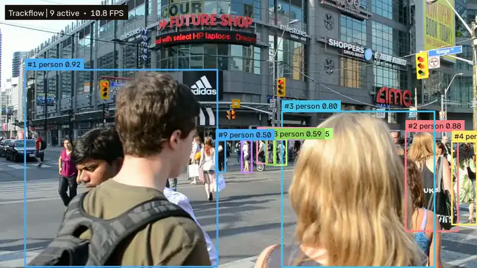
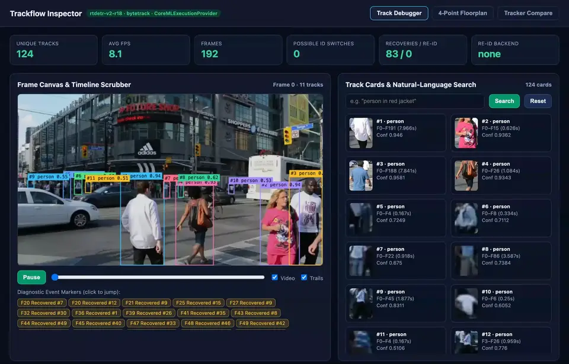
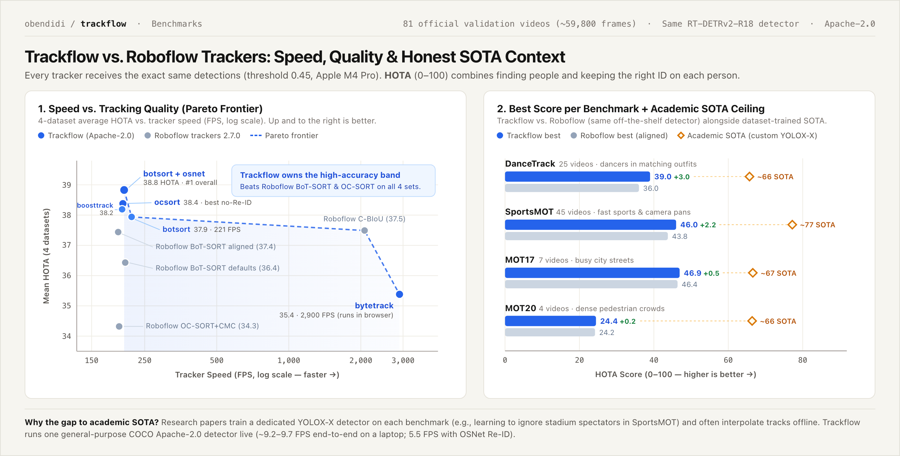
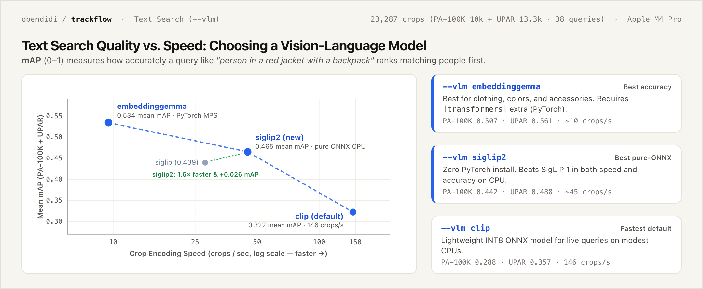

# Trackflow

[](https://github.com/obendidi/trackflow/blob/main/LICENSE)
[](https://pypi.org/project/trackflow-python/)

Real-time people and object tracking in Python and in the browser. Trackflow runs current detectors (RF-DETR, RT-DETRv2, D-FINE, DEIMv2, YOLO26) with ByteTrack, BoT-SORT, OC-SORT, BoostTrack or NLTrack, streams or exports track data (Parquet, JSONL, CSV, MOTChallenge, HTML), and includes text-based track search, a local run inspector with 4-point floorplan projection, and anonymization.



*`trackflow run crossing.mp4` with the default settings, at 12 FPS on an Apple M4 Pro CPU. Footage: 8 seconds of [DiagonalCrosswalkYongeDundas.webm](https://commons.wikimedia.org/wiki/File:DiagonalCrosswalkYongeDundas.webm) by Raysonho, CC0.*



*`trackflow inspect` on the same clip: scrubbing with live video frames, jumping to recovery events, searching Track Cards with natural language, and comparing ByteTrack against BoT-SORT.*

Try it in the browser without installing anything: [obendidi.github.io/trackflow](https://obendidi.github.io/trackflow/) · Full docs & API reference: [obendidi.github.io/trackflow/docs](https://obendidi.github.io/trackflow/docs/).

## Quickstart

One command for your hardware — no system CUDA Toolkit, cuDNN, or TensorRT setup required:

| Environment | Zero-install (`uvx`) | Installed (`pip`) | Notes |
| :--- | :--- | :--- | :--- |
| **CPU / macOS** *(default)* | `uvx trackflow-python run street.mp4` | `pip install trackflow-python` | Auto-pins Apple Silicon to P-cores (~14 FPS on M4 Pro CPU) |
| **macOS GPU (CoreML)** | `uvx trackflow-python run street.mp4 --device coreml` | `pip install trackflow-python` | Runs detector + static-batch OSNet Re-ID on Apple GPU |
| **NVIDIA CUDA** | `uvx trackflow-python-cuda run street.mp4` | `pip install trackflow-python-cuda` | Bundles CUDA + cuDNN; auto-selects CUDA (~37–105 FPS on T4) |
| **NVIDIA TensorRT** *(Py 3.11+)* | `uvx trackflow-python-tensorrt run street.mp4` | `pip install trackflow-python-tensorrt` | Bundles CUDA 13 + TensorRT 10 FP16; cached engines (~94–136 FPS on T4) |

Or run via Docker with zero Python setup (`--target cpu`, `cuda`, or `tensorrt` in [Dockerfile](Dockerfile)):

```bash
docker build --target tensorrt -t trackflow:tensorrt .
docker run --rm --gpus all -v "$PWD:/work" \
  -v "$HOME/.cache/huggingface:/root/.cache/huggingface" \
  -v "$HOME/.cache/trackflow:/root/.cache/trackflow" \
  trackflow:tensorrt run /work/street.mp4
```

After a run finishes, open the local visual inspector:

```bash
trackflow inspect          # opens the most recent run
trackflow info             # checks GPU, execution providers, and recommended command
```

Each run writes to a new folder (`runs/run-1`, `runs/run-2`, …). Pass `-o <dir>` to choose one yourself; it must be empty, so a new run never mixes with files from an old one.

Model weights download from Hugging Face on first run and are cached locally. Every preset is pinned to a specific model revision, so the same command gives the same weights later. ONNX Runtime picks CUDA or CPU automatically; `--device cpu|cuda|coreml|tensorrt` forces one and fails loudly with the exact install command if the matching runtime isn't present. TensorRT builds and caches its engine once per model under `~/.cache/trackflow/trt_cache/` (subsequent runs load in <1s) and automatically keeps `rfdetr-*` in FP32 so DINOv2 activations don't overflow. *Never keep both `onnxruntime` and `onnxruntime-gpu` in the same environment—they share the `onnxruntime` import path and silently break GPU providers.*

<details>
<summary>Verified NVIDIA T4 GPU throughput & parity (CUDA FP32 vs TensorRT 10 FP16)</summary>

Measured on an isolated venv (system CUDA/TRT paths stripped, proving zero-config pip library preloading) on an NVIDIA Tesla T4 (`vtest.avi`, 5-frame box IoU parity vs CPU + 40-frame steady-state timing):

| Model | CUDA FP32 | TensorRT FP16 *(warm)* | Speedup vs CUDA | Mean IoU vs CPU | Cold build → Warm load |
| :--- | ---: | ---: | ---: | ---: | :--- |
| `rtdetr-v2-r18` *(default)* | 26.4 ms (37.9 FPS) | **8.95 ms (111.7 FPS)** | **3.0x** | 0.988 (`37/37`) | 205 s → **0.95 s** |
| `dfine-s` | 21.5 ms (46.5 FPS) | **8.21 ms (121.8 FPS)** | **2.6x** | 0.980 (`54/53`) | 262 s → **0.68 s** |
| `dfine-m` | 33.7 ms (29.6 FPS) | **10.65 ms (93.9 FPS)** | **3.2x** | 0.984 (`42/42`) | 247 s → **1.32 s** |
| `yolo26n` *(AGPL)* | 11.5 ms (86.8 FPS) | **7.37 ms (135.6 FPS)** | **1.6x** | 0.985 (`26/26`) | 261 s → **0.16 s** |
| `rfdetr-nano` | **18.1 ms (55.4 FPS)** | FP32 (`trt_fp16=False`) | — | 1.000 (`30/30`) | Kept in FP32 (FP16 overflows DINOv2) |
| `rfdetr-medium` | **40.5 ms (24.7 FPS)** | FP32 (`trt_fp16=False`) | — | 1.000 (`31/31`) | Kept in FP32 (FP16 overflows DINOv2) |
| `osnet` Re-ID *(8 crops)* | 19.2 ms | **10.5 ms** *(static B=8)* | **1.8x** | 1.000 cos (`0.99996`) | 0.15 s load |

</details>

## Usage

### Tracking and exports

```bash
trackflow run crowd.mp4 \
  --model rfdetr-medium \
  --tracker botsort --reid osnet \
  --classes person,backpack \
  --export parquet,jsonl,csv,mot,html
```

The source can be a video file, a folder of images (read in natural order, `frame_2` before `frame_10`; set the rate with `--fps`), an RTSP/HTTP stream URL, or a camera index. Press Ctrl-C to stop a run: Trackflow stops reading frames and still writes every output, including the track cards that `trackflow search` and `trackflow inspect` read. A second Ctrl-C aborts without writing them.

The Parquet export can be queried directly with DuckDB:

```sql
SELECT track_id, COUNT(*) AS frames, AVG(confidence) AS avg_conf
FROM 'runs/run-1/tracks.parquet'
GROUP BY track_id ORDER BY frames DESC;
```

`--export mot` writes `tracks.txt` in MOTChallenge format, which [TrackEval](https://github.com/JonathonLuiten/TrackEval) scores directly (HOTA, IDF1, MOTA).

### Trackers

| `--tracker` | Algorithm | How it works |
| :--- | :--- | :--- |
| `bytetrack` *(default)* | [ByteTrack](https://arxiv.org/abs/2110.06864) (ECCV 2022) | Matches boxes by overlap, then uses low-confidence detections to keep tracks through partial occlusion. The fastest option. |
| `botsort` | [BoT-SORT](https://arxiv.org/abs/2206.14651) (2022) | ByteTrack plus camera-motion compensation, and appearance matching with `--reid osnet`. |
| `ocsort` | [OC-SORT](https://arxiv.org/abs/2203.14360) (CVPR 2023) | Trusts detections over motion predictions: after an occlusion it re-matches a track to its last observed box and corrects the motion model along the gap. |
| `boosttrack` | [BoostTrack++](https://arxiv.org/abs/2408.13003) (2024) | Raises the confidence of weak detections that fit a track or look like a new object, and matches with motion, shape and, with `--reid osnet`, appearance. Compensates for camera motion. |
| `nltrack` | NLTrack *(pure Apache-2.0, zero extra weights)* | Non-linear motion tracker with damped dual-anchor prediction, observation-centric re-update, scene-calibrated clean-bank Re-ID (`--reid osnet`), and guarded lost-track recovery. Highest accuracy across all four benchmarks. |

All five keep a person and a bag in the same box as separate tracks, and only give out an ID once a track has been seen on more than one frame. OC-SORT and BoostTrack report a track again after a miss once it has matched three frames in a row; in between, the annotated video shows it as a coasting box. The browser playground uses ByteTrack.

#### Benchmarks across 4 official datasets (81 videos, ~59,800 frames)



Every tracker below receives the exact same detections from Trackflow's default Apache-2.0 detector (`rtdetr-v2-r18`, confidence threshold `0.45`, Apple M4 Pro) so the comparison isolates the tracking algorithm.

| Tracker | DanceTrack (25) | SportsMOT (45) | MOT17 (7) | MOT20 (4) | Mean HOTA | Total ID switches | Tracker FPS | End-to-End FPS |
| :--- | ---: | ---: | ---: | ---: | ---: | ---: | ---: | ---: |
| **`nltrack --reid osnet --postprocess`** *(offline)* | **47.5** | **52.5** | **50.8** | **27.9** | **44.7** | **4,294** | 131 | 5.4\* |
| **`nltrack --reid osnet`** | 47.1 | 50.2 | 48.1 | 26.1 | **42.9** | 5,193 | 133 | 5.4 |
| **`botsort --reid osnet --postprocess`** *(offline)* | 42.4 | 50.3 | 49.7 | 25.7 | **42.0** | 4,748 | 198 | 5.5\* |
| **`nltrack`** *(no Re-ID)* | 39.0 | 45.6 | 47.3 | 26.3 | **39.6** | 6,209 | 143 | 9.0 |
| **`botsort --reid osnet`** | 39.0 | 45.0 | 46.9 | 24.4 | 38.8 | 6,435 | 205 | 5.5 |
| **`ocsort`** *(no Re-ID)* | 37.9 | 46.0 | 46.3 | 23.3 | 38.4 | 5,501 | 203 | 9.2 |
| **`boosttrack`** *(no Re-ID)* | 37.5 | 44.4 | 46.9 | 24.0 | 38.2 | 5,549 | 201 | 9.2 |
| **`botsort`** *(no Re-ID)* | 36.7 | 44.3 | 46.5 | 24.3 | 37.9 | 6,475 | 221 | 9.3 |
| `bytetrack` *(also in browser)* | 33.1 | 39.8 | 45.1 | 23.5 | 35.4 | 7,038 | **2,900** | **9.7** |
| *Roboflow `cbiou` (`0.45/0.50`)* | 36.0 | 43.4 | 46.4 | 24.2 | 37.5 | 7,533 | 2,072 | 9.6 |
| *Roboflow `botsort` (`0.45/0.50`)* | 35.9 | 43.6 | 46.3 | 24.0 | 37.4 | 6,922 | 194 | 9.2 |
| *Roboflow `ocsort+cmc` (`0.45`)* | 33.4 | 43.8 | 44.2 | 15.9 | 34.3 | 8,057 | 196 | 9.2 |
| *Roboflow `botsort` (defaults `0.60/0.70`)* | 39.6 | 50.0 | 42.6 | 13.6 | 36.4 | 4,349 | 207 | 9.2 |

#### Offline post-processing (`--postprocess`)

```bash
trackflow run game.mp4 --tracker botsort --reid osnet --postprocess
```

For recorded video files and image folders, `--postprocess` runs a pure NumPy/SciPy pass after tracking finishes: it splits high-confidence mid-track swaps, stitches broken tracklets globally with camera-motion-compensated kinematics and sequence-calibrated OSNet similarity, fills short supported occlusion gaps, and smooths box jitter on steady tracks. Across all 81 validation videos, it improves every dataset and tracker (`+3.2` mean HOTA and `-1,687` ID switches vs the online table row on `botsort --reid osnet`; `+0.7` to `+1.1` without Re-ID) in `~64–265 ms/video` (max `397 ms`). It is opt-in, rejects live camera/RTSP streams, buffers track records and float16 Re-ID embeddings in memory (`~1 KB/observation` when `--reid osnet` is active — split multi-hour crowded clips or omit `--reid` if RAM is tight), and leaves `stream()` and browser ByteTrack untouched. \*Table End-to-End FPS (`5.5`) measures detection + tracking + postprocess (`--no-video`); saving `annotated.mp4` adds a second decode/render pass. Benchmarks used `frame_stride=1` on 14–30 fps footage; time horizons are expressed in seconds and frame stride. Combine with `--reid-merge` to also link long cross-exit re-entries in the same offline pass.

**How to read this chart and table:**
- **HOTA (0–100, higher is better)**: Overall tracking accuracy. It combines two halves equally: finding the right people in each frame and keeping the same ID on each person as they move and cross paths.
- **ID switches (lower is better)**: How many times a tracker accidentally swaps or resets a person's ID mid-video.
- **Tracker FPS vs. End-to-End FPS**: Tracker FPS is the matching step alone; End-to-End FPS includes running the object detector (and person Re-ID crops when enabled) on every frame on a laptop.
- **The 4 benchmarks**: **DanceTrack** (25 videos of dancers wearing identical outfits—tests motion tracking when appearance doesn't help), **SportsMOT** (45 fast-moving basketball, football, and volleyball clips with panning cameras), **MOT17** (7 busy street scenes), and **MOT20** (4 dense pedestrian crowds, second halves).
- **Why academic SOTA is higher (~66–77 HOTA)**: Leaderboard papers train a specialist detector (usually YOLOX-X) directly on each benchmark—so it learns, for example, to ignore spectators in SportsMOT stands—and often fill gaps offline after the video ends. Trackflow runs one off-the-shelf, general-purpose Apache-2.0 COCO detector live, frame by frame. On SportsMOT, Roboflow's high default threshold (`0.60/0.70`) similarly filters out blurry spectators (`50.0` HOTA), at the cost of dropping occluded pedestrians on MOT17 (`42.6`) and MOT20 (`13.6`). Pass `--threshold 0.6` in Trackflow on sports broadcasts if you want the same crowd filtering.

[`scripts/eval_benchmarks.py`](https://github.com/obendidi/trackflow/blob/main/scripts/eval_benchmarks.py) reproduces all four datasets and the Roboflow `trackers==2.7.0` controls (scored with `trackers eval`, which matches TrackEval). Scenes vary widely, so test on footage like yours with `trackflow compare` or `--export mot`.

### Text search and re-identification

```bash
# Highlight matching people live (uses CLIP by default; --vlm embeddinggemma for clothing and accessories)
trackflow run mall.mp4 --query "person in red jacket with a backpack"

# Search a completed run later without re-running detection
# (requires a run created with --query or --vlm clip|siglip|siglip2|embeddinggemma)
trackflow search runs/run-1 "person carrying a suitcase"

# Export top search hits as time windows + normalized boxes for SAM 3 or a VLM
trackflow search runs/run-1 "person in red jacket" --top-k 5 --pad-s 1.0 --export-prompts prompts.json

# Give people who leave and come back their earlier ID (opt-in, uses person Re-ID)
trackflow run mall.mp4 --reid osnet --reid-merge
```



Tested across all **23,287 labeled pedestrian crops** in the PA-100K (10,000 crops, 18 clothing/accessory queries) and UPAR (13,287 crops, 20 color/attribute queries) validation sets, measured with **mAP** (Mean Average Precision, 0–1: how accurately matching people rank at the top of search results) via [`scripts/eval_text_search.py`](https://github.com/obendidi/trackflow/blob/main/scripts/eval_text_search.py):

- **`--vlm embeddinggemma`** *(PyTorch, needs `pip install "trackflow-python[transformers]"`)*: highest accuracy (**0.507** PA-100K / **0.561** UPAR mAP, ~10 crops/s on M4 Pro MPS).
- **`--vlm siglip2`** *(pure ONNX INT8, zero PyTorch)*: best lightweight choice (**0.442** PA-100K / **0.488** UPAR mAP at ~45 crops/s on CPU—both faster and more accurate than SigLIP 1 at `0.420 / 0.459` and ~28 crops/s).
- **`--vlm clip`** *(default, pure ONNX INT8)*: fastest option (**146 crops/s** on CPU, `0.288 / 0.357` mAP).

CLIP, SigLIP, SigLIP 2 and EmbeddingGemma 2 match images to *text*; they cannot reliably distinguish two people in similar clothes, so they are never used for identity. `--reid osnet` runs a dedicated person re-identification model. Re-entry merging only considers people who left before the new track appeared and stayed gone longer than the tracker's own recovery window, and merges only when one earlier person is clearly the best match; look-alikes stay separate. It can still make mistakes on low-resolution footage, which is why it is off by default.

### Inspector, tracker comparison, and floorplan projection

```bash
# Compare ByteTrack and BoT-SORT on the same video and open the inspector
trackflow compare crowd.mp4 --trackers bytetrack,botsort --inspect

# Open the inspector on any existing run
trackflow inspect runs/run-1
```

`trackflow inspect` starts a local web UI where you can scrub through frames, jump to flagged ID switches or recoveries, search track cards, compare two runs, and click 4 ground corners to project 2D tracks onto a top-down floorplan.

### Line counting

```bash
# Count people crossing a doorway, in each direction
trackflow run entrance.mp4 --line "door=640,300,640,720"
```

`--line` takes a line segment in image pixels as `name=x1,y1,x2,y2` (the name is optional) and can be repeated. A track crosses when the bottom center of its box moves from one side of the segment to the other and stays there for 0.3 seconds, so a box edge that jumps back and forth when people overlap doesn't count each jump. A crossing to the right of the direction from the first point to the second counts as `in`, the other way as `out`. For a line drawn left to right, `in` means moving down the frame, and the annotated video shows an arrow on the `in` side. Every crossing counts, so someone who steps back over the line adds one in each direction. Put the line where people's feet stay in view: when someone closer to the camera hides a person's legs, that person's box ends higher, and a line just above their feet can count a crossing that didn't happen.

The totals go to the run summary, `summary.json` (`line_counts`) and the HTML report. Each crossing is also a `line_crossed` event in `events.json`, with the track ID, class and direction. In Python, pass `lines=[CountingLine("door", (640, 300), (640, 720))]` to `TrackflowPipeline`; `stream()` reports crossings in each frame's `events`.

### Anonymization

```bash
# Blur the top of each person box, where the head usually is
trackflow run lobby.mp4 --anonymize face-blur

# Draw stick figures on a blank canvas (box-based, no pose model; no video pixels saved)
trackflow run lobby.mp4 --anonymize skeleton
```

Available modes are `face-blur`, `blur`, `pixelate`, and `skeleton`. Anonymization covers every detected person box (including low-confidence detections and people briefly missed by the tracker), even when you track other classes, and anonymized runs do not write person crops or thumbnails. It is best effort: if the detector misses someone in a frame, that person is not blurred in that frame.

`face-blur` runs no face detector. It blurs an ellipse over the top 30% of each person box, so it misses a face that isn't there, for example on someone lying down, bending over or holding their arms up. Use `blur` or `pixelate` to cover the whole person.

### Benchmarking

```bash
trackflow benchmark crowd.mp4 --models rfdetr-nano,rtdetr-v2-r18 --trackers bytetrack,botsort --split-screen
```

Runs the selected detector/tracker pairs on a video (or a generated synthetic clip if no video is given) and writes a Markdown and JSON report. `--split-screen` also renders the first run's annotated video next to a panel with the 2017 version's published speed. The 2017 README only gives that number, not per-frame results to replay.

FPS and track counts don't tell you whether IDs are right. For accuracy, run on a labeled sequence with `--export mot` and score the result with TrackEval.

## Models

Weights download automatically from Hugging Face on first use. `trackflow models` lists every preset (`--json` for scripts).

| Preset | Model | Size (FP32) | License | Notes |
| :--- | :--- | ---: | :--- | :--- |
| `rtdetr-v2-r18` *(default)* | RT-DETRv2 ResNet-18 (640×640) | ~81 MB | Apache-2.0 | Balanced default for crowded scenes |
| `rfdetr-nano` | RF-DETR Nano (384×384) | ~108 MB | Apache-2.0 | Fast on Apple Silicon and WebGPU |
| `rfdetr-small` | RF-DETR Small (512×512) | ~115 MB | Apache-2.0 | |
| `rfdetr-medium` | RF-DETR Medium (576×576) | ~121 MB | Apache-2.0 | |
| `rfdetr-base` | RF-DETR Base (560×560) | ~108 MB | Apache-2.0 | |
| `rfdetr-large` | RF-DETR Large (704×704) | ~136 MB | Apache-2.0 | Most accurate preset; needs the `transformers` extra |
| `dfine-n` | D-FINE Nano (640×640) | ~15 MB | Apache-2.0 | Small download |
| `dfine-s` | D-FINE Small (640×640) | ~42 MB | Apache-2.0 | Compact COCO-only ONNX |
| `dfine-m` | D-FINE Medium (640×640) | ~79 MB | Apache-2.0 | Highest Apache-2.0 ONNX MOT17 HOTA |
| `yolo26n` … `yolo26x` | YOLO26 Nano to XLarge (640×640) | 10–223 MB | **AGPL-3.0** | Commercial use needs an Ultralytics license |
| `deimv2-atto` | DEIMv2 Atto (320×320) | ~2 MB | **Non-commercial** | Tiny edge model, FP32 only |
| `deimv2-s` | DEIMv2 Small, DINOv3 backbone (640×640) | ~41 MB | **Non-commercial** + DINOv3 | FP32 only |

Most presets also have `--precision fp16` and `int8` variants. Trackflow itself is Apache-2.0, but each model's weights carry their own license, so check the table before shipping a product. With ByteTrack on the MOT17 split used for the [tracker scores](#trackers):

| Preset | HOTA | IDF1 | MOTA |
| :--- | ---: | ---: | ---: |
| `dfine-m` | 46.5 | 55.1 | 39.2 |
| `rtdetr-v2-r18` *(default)* | 45.1 | 53.9 | 39.8 |
| `rfdetr-large` | 44.3 | 51.1 | 35.9 |
| `rfdetr-medium` | 42.9 | 49.7 | 34.8 |
| `yolo26n` | 37.4 | 41.4 | 27.9 |
| `rfdetr-nano` | 36.5 | 40.5 | 28.2 |

`dfine-m` scores highest here (`46.5` HOTA with ByteTrack, `46.9` with BoT-SORT) while `rtdetr-v2-r18` remains the faster default (`10.0` vs `7.3` FPS on M4 Pro CoreML). Test on footage like yours before switching.

You aren't limited to presets. `-m` also takes any compatible ONNX repo on Hugging Face (`owner/repo`), a local `.onnx` file, or, with the extra installed, any Transformers object-detection checkpoint as `hf:owner/repo`:

```bash
pip install "trackflow-python[transformers]"
trackflow run crowd.mp4 -m rfdetr-large
trackflow run crowd.mp4 -m hf:PekingU/rtdetr_v2_r50vd --device mps
```

Re-ID and text-search models:

| Flag | Model | Size | License | Used for |
| :--- | :--- | ---: | :--- | :--- |
| `--reid osnet` | OSNet-AIN x1.0 person Re-ID | ~9 MB | MIT code; weights trained on MSMT17 (check dataset terms for commercial use) | BoT-SORT, BoostTrack, and NLTrack appearance, and `--reid-merge` |
| `--vlm clip` | CLIP ViT-B/32 (INT8) | ~153 MB | MIT | Default for `--query` and `search` |
| `--vlm siglip` | SigLIP Base (INT8) | ~205 MB | Apache-2.0 | Better on fine clothing/attribute queries |
| `--vlm siglip2` | SigLIP 2 Base (INT8) | ~378 MB | Apache-2.0 | Strongest pure-ONNX search (no PyTorch) |
| `--vlm embeddinggemma` | EmbeddingGemma 2 (PyTorch, needs `[transformers]`) | ~1.5 GB | Apache-2.0 | Best on clothing and accessory queries |

## Python API

Run a video and write the same files as the CLI:

```python
from trackflow import TrackflowPipeline

pipeline = TrackflowPipeline(
    model="rfdetr-medium",
    tracker="botsort",
    reid="osnet",                         # person Re-ID for BoT-SORT
    query="person wearing a red jacket",  # scored with CLIP (vlm="clip" by default when query is set)
    anonymize="face-blur",
)
summary = pipeline.run("crowd.mp4")       # or output_dir="runs/crowd"
print(f"{summary.unique_tracks} unique tracks at {summary.avg_fps:.1f} FPS")
```

Or feed frames from your own loop and get tracks back, with nothing written to disk:

```python
import cv2
from trackflow import TrackflowPipeline

pipeline = TrackflowPipeline(model="rfdetr-nano")
cap = cv2.VideoCapture("rtsp://camera.local/stream")

def frames():
    while True:
        ok, frame = cap.read()
        if not ok:
            return
        yield frame  # BGR uint8

for result in pipeline.stream(frames(), fps=25):
    for track in result.tracks:
        print(result.frame_idx, track.track_id, track.class_name, track.bbox)
```

To use your own model, pass any object with a `detect(frame_bgr) -> list[Detection]` method as `detector=`. A custom tracker goes in `tracker_factory=`, which takes any object with `update(detections, frame_bgr=None) -> list[Track]`. The built-in trackers are exported too (`ByteTracker`, `BotSortTracker`, `OcSortTracker`, `BoostTracker`), so you can tune one, for example `tracker_factory=lambda: BoostTracker(use_cmc=False)` for a fixed camera. The package ships type hints (`py.typed`), and `Detector` and `Tracker` are exported as protocols.

## Agent skills

Use Trackflow — and its ONNX computer-vision deployment checklist — from Claude Code, Codex, Antigravity, Cursor, or OpenCode by installing the bundled skills (or point doc-fetchers at [`llms.txt`](https://obendidi.github.io/trackflow/llms.txt)):

- [`trackflow`](skills/trackflow/SKILL.md): run local tracking, line counting, text search, floorplan projection, anonymization, and exports.
- [`onnx-vision-deploy`](skills/onnx-vision-deploy/SKILL.md): empirical checklist for ONNX vision deployment across CPU, CUDA, Apple Silicon CoreML, and browser WebGPU/WASM parity.

```bash
npx skills add obendidi/trackflow
```

## Migration & integration guides

- [Migrating from Google Cloud Video Intelligence (`OBJECT_TRACKING`)](docs/migrate-google-video-intelligence.md)
- [Migrating from AWS Rekognition (`StartPersonTracking` / People Pathing)](docs/migrate-aws-rekognition.md)
- [Using Trackflow alongside SAM 3 (track & filter locally, segment selectively)](docs/sam3-handoff.md)

## Changelog

What changed in each version is in [CHANGELOG.md](https://github.com/obendidi/trackflow/blob/main/CHANGELOG.md) and on the [releases page](https://github.com/obendidi/trackflow/releases).

## License

Apache-2.0 — see [LICENSE](https://github.com/obendidi/trackflow/blob/main/LICENSE). Model weights are downloaded separately and keep their own licenses (see [Models](#models)).

The original 2017 `Tracking-with-darkflow` codebase (YOLOv2 + DeepSORT + TensorFlow 1.0) is kept on the [`legacy-2017`](https://github.com/obendidi/trackflow/tree/legacy-2017) branch and [`v1.0-legacy-2017`](https://github.com/obendidi/trackflow/releases/tag/v1.0-legacy-2017) tag under GPL-3.0.
