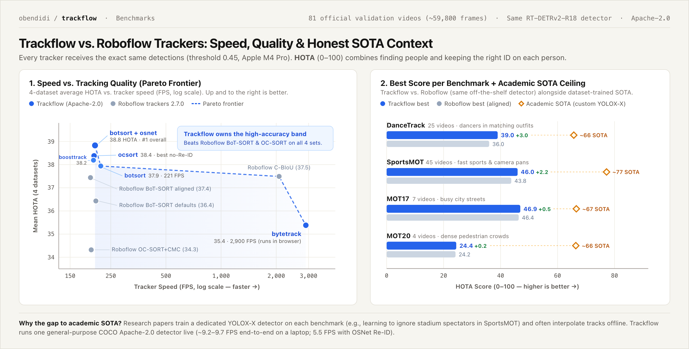
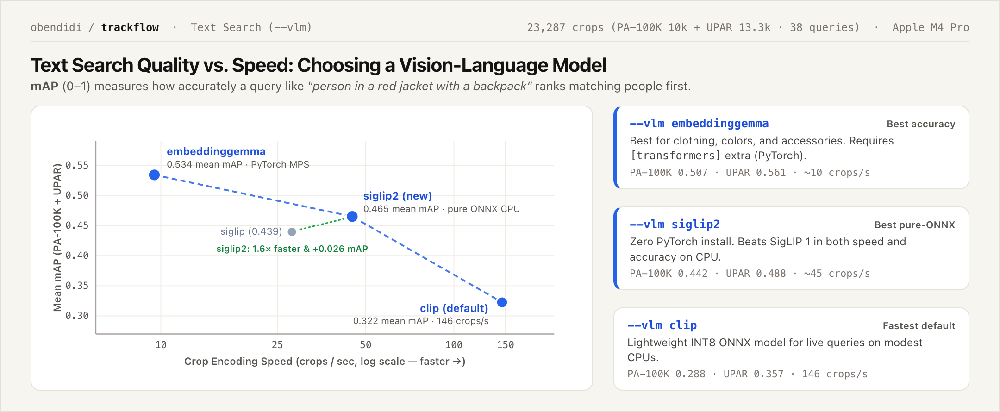

# Benchmarks

All measurements below are reproducible from scripts in the repository. Numbers reflect real runs on standard datasets and public hardware, not cherry-picked synthetic clips.

## Tracker accuracy across 4 official MOT datasets



Evaluated across **81 videos (~59,800 frames)** using identical detections from Trackflow's default Apache-2.0 detector (`rtdetr-v2-r18`, `--threshold 0.45`, Apple M4 Pro) so every row isolates the tracking algorithm alone:

| Tracker | DanceTrack (25) | SportsMOT (45) | MOT17 (7) | MOT20 (4) | Mean HOTA | Total ID switches | Tracker FPS | End-to-End FPS |
| :--- | ---: | ---: | ---: | ---: | ---: | ---: | ---: | ---: |
| **`botsort --reid osnet`** | **39.0** | 45.0 | **46.9** | **24.4** | **38.8** | 6,435 | 205 | 5.5 |
| **`ocsort`** *(no Re-ID)* | 37.9 | **46.0** | 46.3 | 23.3 | **38.4** | **5,501** | 203 | 9.2 |
| **`boosttrack`** *(no Re-ID)* | 37.5 | 44.4 | **46.9** | 24.0 | **38.2** | 5,549 | 201 | 9.2 |
| **`botsort`** *(no Re-ID)* | 36.7 | 44.3 | 46.5 | 24.3 | **37.9** | 6,475 | 221 | 9.3 |
| `bytetrack` *(also in browser)* | 33.1 | 39.8 | 45.1 | 23.5 | 35.4 | 7,038 | **2,900** | **9.7** |
| *Roboflow `cbiou` (`0.45/0.50`)* | 36.0 | 43.4 | 46.4 | 24.2 | 37.5 | 7,533 | 2,072 | 9.6 |
| *Roboflow `botsort` (`0.45/0.50`)* | 35.9 | 43.6 | 46.3 | 24.0 | 37.4 | 6,922 | 194 | 9.2 |
| *Roboflow `ocsort+cmc` (`0.45`)* | 33.4 | 43.8 | 44.2 | 15.9 | 34.3 | 8,057 | 196 | 9.2 |
| *Roboflow `botsort` (defaults `0.60/0.70`)* | 39.6 | 50.0 | 42.6 | 13.6 | 36.4 | 4,349 | 207 | 9.2 |

### How to read these numbers

- **HOTA (0–100, higher is better)**: Balances detection accuracy and association accuracy equally.
- **ID switches (lower is better)**: Count of mid-video ID swaps or resets.
- **Tracker FPS vs End-to-End FPS**: Tracker FPS measures association alone; End-to-End FPS includes per-frame detection (and `osnet` Re-ID crops when enabled) on a laptop.
- **Datasets**: **DanceTrack** (25 clips of dancers in identical outfits), **SportsMOT** (45 fast-panning sports clips), **MOT17** (7 busy street scenes), **MOT20** (4 dense pedestrian crowds, second halves).
- **Why academic SOTA is higher (~66–77 HOTA)**: Leaderboard papers train a specialist detector (usually YOLOX-X) directly on each dataset — learning, for instance, to ignore crowd spectators in SportsMOT — and often interpolate tracks offline after the video ends. Trackflow runs one off-the-shelf, general-purpose Apache-2.0 COCO detector live, frame by frame. Pass `--threshold 0.6` on sports broadcasts for spectator filtering comparable to Roboflow's `0.60/0.70` default.

Reproduce with [`scripts/eval_benchmarks.py`](https://github.com/obendidi/trackflow/blob/main/scripts/eval_benchmarks.py) (controls run `trackers==2.7.0`, scored via `trackers eval`, matching TrackEval).

## Detector accuracy on MOT17 (with ByteTrack)

| Preset | HOTA | IDF1 | MOTA | License |
| :--- | ---: | ---: | ---: | :--- |
| `dfine-m` | **46.5** | **55.1** | 39.2 | Apache-2.0 |
| `rtdetr-v2-r18` *(default)* | 45.1 | 53.9 | **39.8** | Apache-2.0 |
| `rfdetr-large` | 44.3 | 51.1 | 35.9 | Apache-2.0 (`[transformers]`) |
| `rfdetr-medium` | 42.9 | 49.7 | 34.8 | Apache-2.0 |
| `yolo26n` | 37.4 | 41.4 | 27.9 | AGPL-3.0 |
| `rfdetr-nano` | 36.5 | 40.5 | 28.2 | Apache-2.0 |

`dfine-m` scores highest (`46.5` HOTA with ByteTrack, `46.9` with BoT-SORT), while `rtdetr-v2-r18` stays the faster default (`10.0` vs `7.3` FPS on M4 Pro CoreML).

## Natural-language track search (PA-100K & UPAR)



Measured across **23,287 labeled pedestrian crops** (10,000 PA-100K across 18 clothing/accessory queries; 13,287 UPAR across 20 color/attribute queries) with [`scripts/eval_text_search.py`](https://github.com/obendidi/trackflow/blob/main/scripts/eval_text_search.py):

| `--vlm` | PA-100K mAP | UPAR mAP | Speed | Notes |
| :--- | ---: | ---: | :--- | :--- |
| `embeddinggemma` | **0.507** | **0.561** | ~10 crops/s (M4 Pro MPS) | PyTorch (`[transformers]` extra) |
| `siglip2` | **0.442** | **0.488** | ~45 crops/s (CPU ONNX INT8) | Best pure-ONNX preset |
| `siglip` | 0.420 | 0.459 | ~28 crops/s (CPU ONNX INT8) | Pure ONNX INT8 |
| `clip` *(default)* | 0.288 | 0.357 | **146 crops/s** (CPU ONNX INT8) | Fastest screening option |

## GPU throughput & parity (NVIDIA T4 & L4)

### NVIDIA Tesla T4 (CUDA FP32 vs TensorRT 10 FP16)

Measured inside an isolated venv with system CUDA and TensorRT library paths stripped (proving zero-config pip library preloading) on `vtest.avi` (5-frame box IoU parity against CPU + 40-frame steady-state inference timing):

| Model | CUDA FP32 | TensorRT FP16 *(warm)* | Speedup vs CUDA | Mean IoU vs CPU | Cold build → Warm load |
| :--- | ---: | ---: | ---: | ---: | :--- |
| `rtdetr-v2-r18` *(default)* | 26.4 ms (37.9 FPS) | **8.95 ms (111.7 FPS)** | **3.0x** | 0.988 (`37/37`) | 205 s → **0.95 s** |
| `dfine-s` | 21.5 ms (46.5 FPS) | **8.21 ms (121.8 FPS)** | **2.6x** | 0.980 (`54/53`) | 262 s → **0.68 s** |
| `dfine-m` | 33.7 ms (29.6 FPS) | **10.65 ms (93.9 FPS)** | **3.2x** | 0.984 (`42/42`) | 247 s → **1.32 s** |
| `yolo26n` *(AGPL)* | 11.5 ms (86.8 FPS) | **7.37 ms (135.6 FPS)** | **1.6x** | 0.985 (`26/26`) | 261 s → **0.16 s** |
| `rfdetr-nano` | **18.1 ms (55.4 FPS)** | FP32 (`trt_fp16=False`) | — | 1.000 (`30/30`) | Kept in FP32 (FP16 overflows DINOv2) |
| `rfdetr-medium` | **40.5 ms (24.7 FPS)** | FP32 (`trt_fp16=False`) | — | 1.000 (`31/31`) | Kept in FP32 (FP16 overflows DINOv2) |
| `osnet` Re-ID *(8 crops)* | 19.2 ms | **10.5 ms** *(static B=8)* | **1.8x** | 1.000 cos (`0.99996`) | 0.15 s load |

### NVIDIA L4 end-to-end PyPI package verification

End-to-end `trackflow run` (video decode + inference + ByteTrack + Parquet/JSONL export, `--no-video`) verified directly from published PyPI `0.6.1` wheels in a fresh venv with system CUDA/TRT paths stripped (`rtdetr-v2-r18`, `vtest.avi`, 120 frames):

| Package | Active provider | End-to-End FPS | Inference latency |
| :--- | :--- | ---: | ---: |
| `trackflow-python-cuda==0.6.1` | `CUDAExecutionProvider` | 30.1 FPS | 31.1 ms |
| `trackflow-python-tensorrt==0.6.1` *(warm cache)* | `TensorrtExecutionProvider` | **92.8 FPS** | **9.7 ms** |

## Benchmark on your own hardware

```bash
trackflow benchmark footage.mp4 \
  --models rfdetr-nano,rtdetr-v2-r18,dfine-s \
  --trackers bytetrack,botsort,ocsort
```

Omitting the video argument generates a synthetic crowd clip automatically. Add `--split-screen` to render a side-by-side comparison clip against the original 2017 Trackflow baseline speed.
