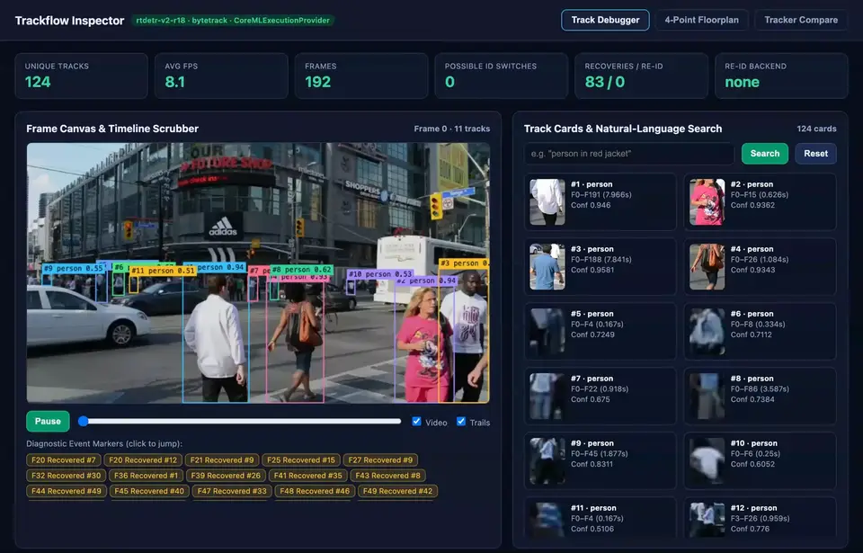

# Analytics, Inspector & Privacy

Beyond raw bounding boxes, Trackflow ships built-in directional line counting, 4-point floorplan projection with dwell zones, a local visual run inspector, DuckDB-ready Parquet exports, and frame-level anonymization.

## Line counting (`--line`)

Count objects crossing one or more line segments in image pixel coordinates:

```bash
trackflow run entrance.mp4 \
  --line "door=640,300,640,720" \
  --line "stairs=120,500,400,500"
```

### How crossings are computed

- **Anchor point**: Uses the bottom center of each track's bounding box (where a person's feet touch the floor).
- **Debounce**: A track must remain on the new side of the segment for **0.3 seconds** before a crossing is recorded, preventing double-counts when overlapping boxes jitter across the line.
- **Direction (`in` vs `out`)**: Crossing to the **right** of the vector from `(x1, y1)` to `(x2, y2)` counts as `in`; the opposite direction counts as `out`. For a horizontal line drawn left-to-right, `in` means moving downward in the frame. The annotated video draws an arrow indicating the `in` side.
- **Repeat crossings**: Someone who crosses and steps back adds one `in` and one `out`.
- **Placement tip**: Draw lines where feet stay unobstructed. If a closer pedestrian blocks someone's legs, their bounding box bottoms out higher in the frame and can trip a line placed just above their shoes.

Totals are written to `summary.json` (`line_counts`), the HTML report, and per-event `line_crossed` entries in `events.json`.

In Python:

```python
from trackflow import CountingLine, TrackflowPipeline

door = CountingLine("door", (640, 300), (640, 720))
pipeline = TrackflowPipeline(model="rtdetr-v2-r18", lines=[door])

# Batch run
summary = pipeline.run("entrance.mp4")
print(summary.line_counts)  # {"door": {"in": 12, "out": 9}}

# Or streaming: read result.events on each FrameResult
```

## 4-point floorplan homography & dwell zones

Project 2D camera foot points into top-down floorplan coordinates (`world_x`, `world_y` in meters) and named polygon `zone` labels.

### Interactive calibration in the inspector

1. Run Trackflow once on your video: `trackflow run lobby.mp4`
2. Open the inspector: `trackflow inspect runs/run-1`
3. In the Floorplan tab, click 4 ground corners in the video frame, set their real-world width and height in meters, optionally draw dwell zones, and export `homography.json`.
4. Reuse that calibration on every future clip from the same camera:

```bash
trackflow run lobby_day2.mp4 --homography homography.json
```

### Calibration JSON format

```json
{
  "image_points": [[210, 420], [980, 425], [1160, 690], [60, 680]],
  "world_points": [[0.0, 0.0], [8.0, 0.0], [8.0, 6.0], [0.0, 6.0]],
  "width_m": 8.0,
  "height_m": 6.0,
  "zones": [
    {
      "name": "checkout",
      "polygon": [[0.5, 0.5], [3.5, 0.5], [3.5, 2.5], [0.5, 2.5]],
      "color": "#38bdf8"
    }
  ]
}
```

When `--homography` is provided, every observation row in `tracks.parquet`, `tracks.jsonl`, and `tracks.csv` includes populated `world_x`, `world_y`, and `zone` columns. You can also build calibrations programmatically with `FloorplanHomography` and `DwellZone` (see [Python API](../reference/python-api.md#analytics-privacy)).

## Querying `tracks.parquet` with DuckDB

Every `trackflow run` exports `tracks.parquet` (Snappy-compressed Arrow Parquet) by default, ready for SQL analytics without loading raw video again:

```sql
-- Top 10 longest-dwelling people
SELECT
  track_id,
  MIN(timestamp_s) AS first_seen_s,
  MAX(timestamp_s) AS last_seen_s,
  ROUND(MAX(timestamp_s) - MIN(timestamp_s), 2) AS dwell_s,
  COUNT(*) AS frames,
  ROUND(AVG(confidence), 3) AS avg_conf
FROM 'runs/run-1/tracks.parquet'
WHERE class_name = 'person'
GROUP BY track_id
ORDER BY dwell_s DESC
LIMIT 10;
```

```sql
-- Dwell time per floorplan zone (requires --homography with zones)
SELECT
  zone,
  COUNT(DISTINCT track_id) AS unique_visitors,
  COUNT(*) AS observations
FROM 'runs/run-1/tracks.parquet'
WHERE zone IS NOT NULL AND zone != ''
GROUP BY zone
ORDER BY unique_visitors DESC;
```

## Local visual inspector (`trackflow inspect`)



Start the local web UI on the most recent run (or pass a specific run folder):

```bash
trackflow inspect
trackflow inspect runs/run-1 --compare runs/run-2
```

Inside the inspector you can:

- Scrub frames with real video frames rendered behind track boxes and trails
- Jump directly to occlusion recovery events and suspected ID switches
- Run natural-language searches over saved Track Cards
- Calibrate a 4-point floorplan homography and preview top-down trajectories and heatmaps
- Compare two tracker runs side by side (`--compare`)

By default the inspector binds to `127.0.0.1:8765` and never sends video outside your machine.

## Privacy anonymization (`--anonymize`)

Mask detected people in the exported video and suppress saving person thumbnails:

```bash
trackflow run lobby.mp4 --anonymize face-blur
trackflow run lobby.mp4 --anonymize skeleton
```

| Mode | Output |
| :--- | :--- |
| `face-blur` | Blurs an ellipse over the top 30% of every detected person box |
| `blur` | Gaussian-blurs the entire person bounding box |
| `pixelate` | Mosaic-pixelates the entire person bounding box |
| `skeleton` | Draws stick-figure proxies on a blank canvas (no source video pixels saved; box-based, no pose model) |

### Important limits to know

- **Covers all person detections**: Anonymization masks every detected person box — including low-confidence detections and people temporarily missed by the tracker — even if `--classes` is set to another class. Anonymized runs never write person crops or thumbnails.
- **Best-effort on detector misses**: If the detector misses a person on a given frame, that person is not blurred on that frame.
- **`face-blur` uses no face detector**: It masks the top 30% of the person box. If someone is lying down, bending over, or raising their arms, their head can sit outside that region. Use `blur` or `pixelate` when full coverage is required.
