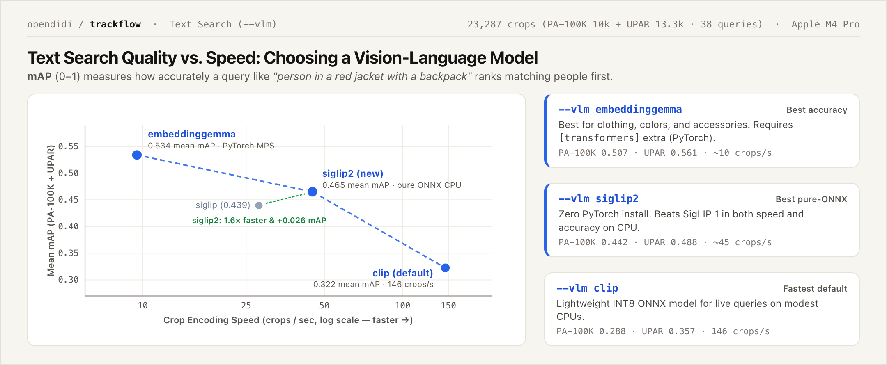

# Text Search & Re-ID

Trackflow separates two problems that look similar on the surface but need different models:

1. **Text search (`--vlm`, `--query`, `trackflow search`)**: Matches a person's crop against a plain-English description such as *"person in a red jacket carrying a backpack"*.
2. **Identity matching (`--reid osnet`, `--reid-merge`)**: Decides whether two crops belong to the **same individual** across occlusions or room exits.

Vision-language models (CLIP, SigLIP, SigLIP 2, EmbeddingGemma 2) are trained for image-to-text alignment, not person identity — on `vtest.avi`, two different people scored `0.83` cosine similarity on average versus `0.86` for the same person. Trackflow therefore never uses VLMs for track identity; identity always uses a dedicated Re-ID encoder (`osnet`).

## Live text search (`--query`)

Highlight tracks matching a text prompt during a run:

```bash
trackflow run mall.mp4 --query "person in red jacket with a backpack"
```

When `--query` is passed without `--vlm`, Trackflow defaults to `--vlm clip`. Every observation in `tracks.parquet` and `tracks.jsonl` gets a `query_score` (cosine similarity) and `query_match` boolean.

Override the match threshold with `--query-threshold` if needed. Built-in defaults are calibrated per VLM:

| `--vlm` | Default `--query-threshold` | Runtime |
| :--- | ---: | :--- |
| `clip` | `0.27` | Pure ONNX (INT8) |
| `siglip` | `0.08` | Pure ONNX (INT8) |
| `siglip2` | `0.09` | Pure ONNX (INT8) |
| `embeddinggemma` | `0.71` | PyTorch (`[transformers]` extra) |

## Offline search over saved Track Cards (`trackflow search`)

To index every track once and run unlimited queries later without re-running detection, pass `--vlm` during `trackflow run`:

```bash
# 1. Track once and save Track Card embeddings (no video render needed)
trackflow run lobby_2h.mp4 --vlm siglip2 --no-video

# 2. Search the saved run in milliseconds with any number of queries
trackflow search runs/run-1 "person carrying a suitcase"
trackflow search runs/run-1 "woman in yellow coat" --top-k 5 --json
```

Trackflow saves each track's highest-confidence crop and VLM embedding into `track_cards.json` (plus thumbnail images unless `--anonymize` is active). You can also run natural-language queries interactively inside `trackflow inspect`.

## Choosing a VLM



Evaluated across **23,287 labeled pedestrian crops** from PA-100K (10,000 crops, 18 clothing/accessory queries) and UPAR (13,287 crops, 20 color/attribute queries) via `scripts/eval_text_search.py`:

| `--vlm` | PA-100K mAP | UPAR mAP | Throughput | Dependency |
| :--- | ---: | ---: | :--- | :--- |
| `embeddinggemma` | **0.507** | **0.561** | ~10 crops/s (M4 Pro MPS) | `trackflow-python[transformers]` |
| `siglip2` | **0.442** | **0.488** | ~45 crops/s (CPU ONNX INT8) | Core (pure ONNX) |
| `siglip` | 0.420 | 0.459 | ~28 crops/s (CPU ONNX INT8) | Core (pure ONNX) |
| `clip` *(default)* | 0.288 | 0.357 | **146 crops/s** (CPU ONNX INT8) | Core (pure ONNX) |

- Use **`siglip2`** as the default upgrade when you want noticeably better clothing and attribute accuracy without installing PyTorch.
- Use **`embeddinggemma`** when search accuracy matters more than throughput and you already have PyTorch/MPS/CUDA.
- Use **`clip`** for maximum speed on CPU or quick screening.

## Exporting prompt windows for SAM 3 or VLMs

Turn top text-search hits into a structured JSON manifest (`trackflow.prompts.v1`) with padded time windows and normalized `[0, 1]` boxes/points:

```bash
trackflow search runs/run-1 "person carrying a red backpack" \
  --top-k 5 --pad-s 1.0 --export-prompts prompts.json
```

This lets Trackflow scan hours of footage locally and hand only the few relevant 5-second clips to a heavy segmentation model. See the [SAM 3 Handoff guide](../sam3-handoff.md) for a full runnable example.

## Cross-exit re-identification (`--reid-merge`)

If a person walks out of view for longer than the tracker's short occlusion buffer and returns later, `--reid-merge` can assign their earlier `track_id`:

```bash
trackflow run entrance.mp4 --tracker botsort --reid osnet --reid-merge
```

How Trackflow limits false merges:

- **Disjoint time windows**: Only compares against tracks that ended before the new track started, and stayed absent longer than the tracker's internal recovery window.
- **Unambiguous winner**: Merges only when one prior track exceeds the similarity threshold with a clear margin over the runner-up; look-alikes remain separate.
- **Opt-in by default**: Low-resolution or dark footage can still produce false merges, so `--reid-merge` is off unless explicitly enabled.

Merged tracks are counted in `summary.json` (`reid_merges`).
