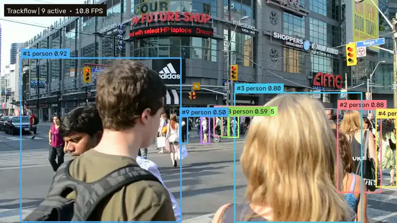

# Trackflow

Local people and object tracking in Python and the browser, licensed under **Apache-2.0**.

Trackflow pairs ONNX Runtime detectors (`rtdetr-v2-r18`, `rfdetr-*`, `dfine-*`, optional `yolo26*`, `deimv2-*`, or `hf:` Transformers) with four multi-object trackers (**ByteTrack**, **BoT-SORT**, **OC-SORT**, **BoostTrack++**). It streams or exports structured tables (Parquet, JSONL, CSV, MOTChallenge, HTML), searches tracks in plain English (CLIP, SigLIP, SigLIP 2, EmbeddingGemma 2), counts line crossings, projects trajectories onto a 4-point floorplan, and anonymizes footage locally.



*`trackflow run crossing.mp4` with default settings at 12 FPS on an Apple M4 Pro CPU. Footage: 8 seconds of [DiagonalCrosswalkYongeDundas.webm](https://commons.wikimedia.org/wiki/File:DiagonalCrosswalkYongeDundas.webm) by Raysonho, CC0.*

Try it directly in your browser without installing anything: **[WebGPU / WASM Browser Demo](https://obendidi.github.io/trackflow/)**.

## One-command quickstart

Pick the command that matches your machine. GPU packages bundle CUDA, cuDNN, and TensorRT wheels so you do not need to install the CUDA Toolkit or set `LD_LIBRARY_PATH`.

=== "CPU / macOS"

    ```bash
    # Zero-install CLI (auto-pins Apple Silicon to performance cores)
    uvx trackflow-python run street.mp4

    # Or install persistently
    pip install trackflow-python
    trackflow run street.mp4
    ```

=== "macOS GPU (CoreML)"

    ```bash
    uvx trackflow-python run street.mp4 --device coreml
    ```

=== "NVIDIA CUDA"

    ```bash
    # Bundles CUDA + cuDNN; auto-selects CUDAExecutionProvider
    uvx trackflow-python-cuda run street.mp4

    # Or install persistently
    pip install trackflow-python-cuda
    trackflow run street.mp4
    ```

=== "NVIDIA TensorRT"

    ```bash
    # Python 3.11+. Bundles CUDA 13 + TensorRT 10 FP16; caches compiled engines
    uvx trackflow-python-tensorrt run street.mp4

    # Or install persistently
    pip install trackflow-python-tensorrt
    trackflow run street.mp4
    ```

=== "Docker"

    ```bash
    # Available build targets: cpu, cuda, tensorrt
    docker build --target tensorrt -t trackflow:tensorrt .
    docker run --rm --gpus all -v "$PWD:/work" \
      -v "$HOME/.cache/huggingface:/root/.cache/huggingface" \
      -v "$HOME/.cache/trackflow:/root/.cache/trackflow" \
      trackflow:tensorrt run /work/street.mp4
    ```

After a run finishes, open the local inspector or verify your active hardware provider:

```bash
trackflow inspect          # opens the latest run in a local web UI
trackflow info             # prints GPU, ONNX Runtime providers, and recommended command
```

## Where to go next

| Goal | Page |
| :--- | :--- |
| Choose the right package, check GPU providers, or run in Docker | [Installation & Hardware](getting-started/installation.md) |
| Pick between ByteTrack, BoT-SORT, OC-SORT, and BoostTrack++ | [Trackers](guides/trackers.md) |
| Check model licenses, sizes, precisions, or load custom ONNX / `hf:` weights | [Models & Licenses](guides/models.md) |
| Search tracks in plain English or re-link people across exits | [Text Search & Re-ID](guides/search.md) |
| Count doorway crossings, calibrate a floorplan, query Parquet, or blur people | [Analytics, Inspector & Privacy](guides/analytics.md) |
| See 4-dataset HOTA scores, PA-100K/UPAR search mAP, and NVIDIA T4 / L4 speeds | [Benchmarks](benchmarks.md) |
| Replace Google Cloud Video Intelligence or AWS Rekognition | [Google Cloud](migrate-google-video-intelligence.md) · [AWS Rekognition](migrate-aws-rekognition.md) |
| Look up CLI flags, output files, Parquet schema, or Python classes | [CLI & Output Schema](reference/cli.md) · [Python API](reference/python-api.md) |
